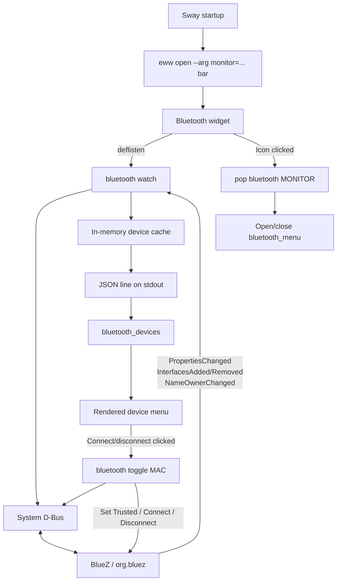

# Eww Bluetooth architecture

The Bluetooth widget is split into two independent paths:

- A long-lived, event-driven `watch` process maintains UI state.
- Short-lived `toggle` processes perform connect and disconnect actions.

This avoids the previous two-second polling cycle and its repeated
`bluetoothctl`, `awk`, `jq`, and `timeout` subprocesses.



## Bar startup and monitor propagation

Sway starts the bar with a concrete output name. The physical profile uses:

```sh
eww daemon && eww open --arg monitor=DP-1 bar
```

The VirtualBox profile passes `Virtual-1` instead. The `monitor` argument flows
through the widget hierarchy in
[`bar/eww.yuck`](../config/eww/bar/eww.yuck):

```text
bar(monitor)
  `- right(monitor)
       `- bluetooth(monitor)
```

The Bluetooth icon therefore has the monitor that owns the bar. Clicking it
runs:

```sh
./bar/scripts/pop bluetooth DP-1
```

The [popup controller](../config/eww/bar/scripts/pop):

1. Validates the popup name and monitor argument.
2. Converts the public name `bluetooth` to the Eww window name
   `bluetooth_menu`.
3. Runs `eww active-windows` once and saves the result.
4. Runs `eww close bluetooth_menu` if the target is already open.
5. Otherwise closes any other known popup and runs:

   ```sh
   eww open --arg monitor=DP-1 bluetooth_menu
   ```

Passing the monitor through the widget tree avoids relying on mutable global
Eww state.

## Watcher startup

The [Bluetooth widget](../config/eww/bar/widgets/bluetooth.yuck) defines its
state as an Eww listening variable:

```lisp
(deflisten bluetooth_devices :initial "[]" "./bar/scripts/bluetooth watch")
```

The initial value gives Eww a valid empty array before Python produces its
first result. Every subsequent line written by the command to stdout replaces
the value of `bluetooth_devices`.

The `watch` command reaches `main()` in
[`bar/scripts/bluetooth`](../config/eww/bar/scripts/bluetooth):

1. `argparse` selects the `watch` subcommand.
2. `Gio.bus_get_sync(Gio.BusType.SYSTEM, None)` opens a system D-Bus
   connection. BlueZ runs on the system bus, rather than the per-user session
   bus.
3. The connection is passed to `DeviceWatcher`.
4. `DeviceWatcher.run()` subscribes to signals, loads the initial snapshot,
   installs shutdown handlers, and starts a `GLib.MainLoop`.

Conceptually:

```python
connection = system_dbus_connection()
watcher = DeviceWatcher(connection)
watcher.run()
```

The D-Bus connection transports method calls and incoming signals. The GLib
main loop sleeps efficiently until D-Bus or process signals arrive; it does not
poll Bluetooth state.

Subscriptions are installed before the initial snapshot is read. This avoids
a gap in which a BlueZ change could happen between snapshot creation and signal
subscription.

## Initial device snapshot

`DeviceWatcher._reload()` calls `get_managed_objects()`, which makes this D-Bus
method call:

```text
Destination: org.bluez
Object:      /
Interface:   org.freedesktop.DBus.ObjectManager
Method:      GetManagedObjects
Timeout:     2 seconds
```

The return signature, `a{oa{sa{sv}}}`, represents a mapping from object paths,
to interfaces, to property maps. A device resembles:

```text
/org/bluez/hci0/dev_00_25_D1_44_F9_2E
  org.bluez.Device1
    Address   = "00:25:D1:44:F9:2E"
    Alias     = "Major V"
    Connected = true
    Trusted   = true
```

The watcher keeps only objects that expose `org.bluez.Device1`. Their complete
property dictionaries are stored in memory by BlueZ object path:

```python
self.devices[object_path] = properties
```

The object path is BlueZ's internal device identity. The Bluetooth address is
the identity exposed to the Eww action buttons.

If BlueZ is unavailable, `_reload()` clears the cache, publishes `[]`, and
writes the D-Bus error to stderr. The main loop remains alive so that the
watcher can recover when BlueZ returns.

## D-Bus signal subscriptions

`DeviceWatcher._subscribe()` installs four subscriptions.

### `PropertiesChanged`

This signal is emitted when device properties such as `Connected`, `Alias`, or
`Trusted` change. The signal carries:

```text
changed interface
changed properties
invalidated properties
```

The callback rejects signals that are not for `org.bluez.Device1` or whose
object path is outside `/org/bluez/`. For a known object, it merges the changed
properties into the cache, removes invalidated properties, and calls `_emit()`.

If the object is not in the cache, the watcher performs a complete `_reload()`
instead. This restores a consistent snapshot rather than guessing the missing
device state.

This signal normally changes the menu button from `connect` to `disconnect`
after a connection succeeds.

### `InterfacesAdded`

BlueZ emits this when a new D-Bus interface appears. If the new interface map
contains `org.bluez.Device1`, the callback adds its initial properties to the
cache and emits a new device list.

### `InterfacesRemoved`

BlueZ emits this when interfaces disappear. If `org.bluez.Device1` was removed,
the callback removes that object path from the cache and emits the reduced
list.

### `NameOwnerChanged`

This signal comes from the D-Bus daemon and is filtered for the service name
`org.bluez`. It lets the watcher handle BlueZ restarts:

- If BlueZ loses its bus owner, the watcher clears its cache and emits `[]`.
- If BlueZ receives a new owner, the watcher reloads the complete snapshot.

Eww therefore does not need to be restarted when the Bluetooth service
restarts.

## Publishing state to Eww

`DeviceWatcher._emit()` projects the full BlueZ property cache into the smaller
JSON structure needed by the UI:

```json
[
  {
    "address": "00:25:D1:44:F9:2E",
    "connected": true,
    "name": "Major V"
  }
]
```

For every device:

- `address` comes from `Address`.
- `connected` comes from `Connected` and defaults to `false`.
- `name` prefers `Alias`, then `Name`, then the address.

Devices are sorted by case-insensitive name and then address, producing stable
menu ordering. The JSON is serialized compactly and compared with
`last_payload`. If the visible state did not change, the watcher prints
nothing. Otherwise it runs the equivalent of:

```python
print(payload, flush=True)
```

Flushing makes the new line immediately available to Eww. The widget iterates
over `bluetooth_devices` with:

```lisp
(for device in bluetooth_devices ...)
```

Each device's `connected` value directly determines its icon, CSS classes,
button label, and action. If Eww closes the listening pipe, Python receives a
broken pipe and exits normally. `SIGINT` and `SIGTERM` stop the GLib main loop.

## Connect and disconnect actions

Clicking a device button starts a separate process:

```sh
./bar/scripts/bluetooth toggle 00:25:D1:44:F9:2E
```

`toggle_device()` follows this path:

1. Validate that the argument is a complete Bluetooth MAC address.
2. Connect to the system D-Bus.
3. Call `GetManagedObjects` for a current snapshot.
4. Locate the BlueZ object whose `Address` matches the requested MAC.
5. Inspect its `Connected` and `Trusted` properties.

The lookup is required because BlueZ methods operate on an object path such as:

```text
/org/bluez/hci0/dev_00_25_D1_44_F9_2E
```

while the Eww widget identifies the device by its MAC address.

If the device is connected, the action calls:

```text
org.bluez.Device1.Disconnect()
```

If the device is disconnected and not trusted, it first calls:

```text
org.freedesktop.DBus.Properties.Set(
    "org.bluez.Device1",
    "Trusted",
    true
)
```

It then calls:

```text
org.bluez.Device1.Connect()
```

Inventory and property calls have a two-second timeout. `Connect` and
`Disconnect` have a ten-second timeout. These synchronous calls block only the
short-lived action process; the independent watcher continues receiving
events.

The action process does not write optimistic state into Eww. BlueZ remains the
source of truth:

```text
Connect or Disconnect call
  -> BlueZ changes Connected
  -> BlueZ emits PropertiesChanged
  -> DeviceWatcher updates its cache
  -> DeviceWatcher prints new JSON
  -> Eww rerenders the device row
```

Errors from argument validation or D-Bus are written to stderr and cause the
action process to exit with status 1.

## Performance characteristics

The previous implementation repeatedly performed:

```text
bluetoothctl devices
  -> bluetoothctl info for every device
  -> several jq processes per device
  -> generate Eww markup
  -> sleep 2 seconds
```

The current read path performs:

```text
one Python process
  -> one initial D-Bus snapshot
  -> wait for D-Bus events in GLib
  -> update only when BlueZ signals a change
```

There is no polling delay, per-device subprocess chain, or generated Yuck
markup. Normal updates require only a BlueZ signal, an in-memory cache update,
one JSON line, and an Eww rerender.
